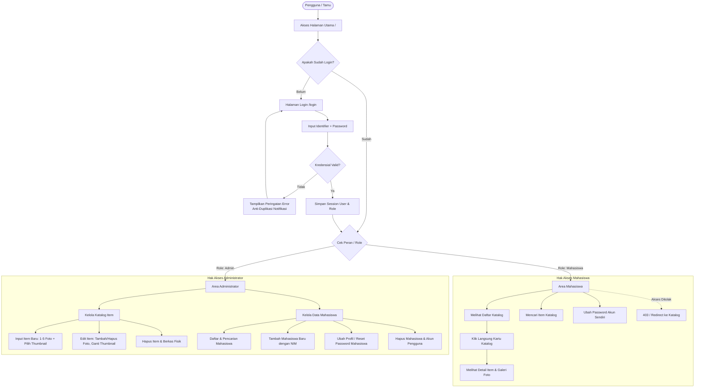
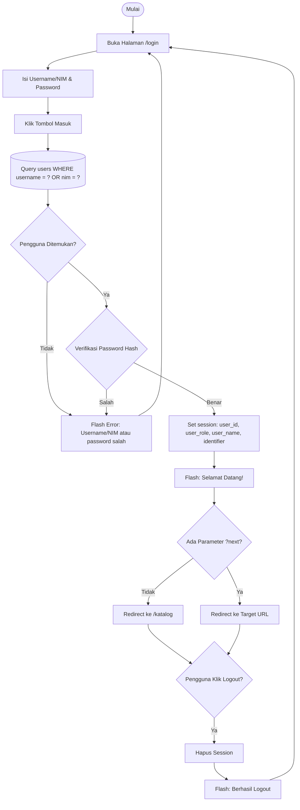
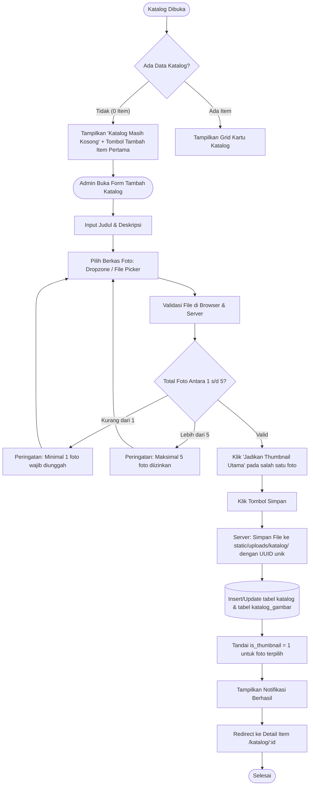
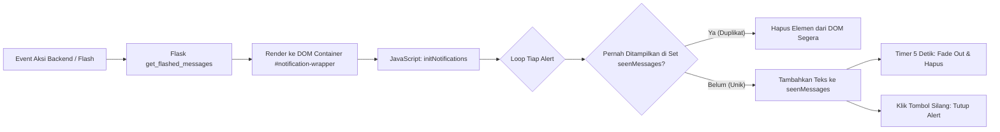
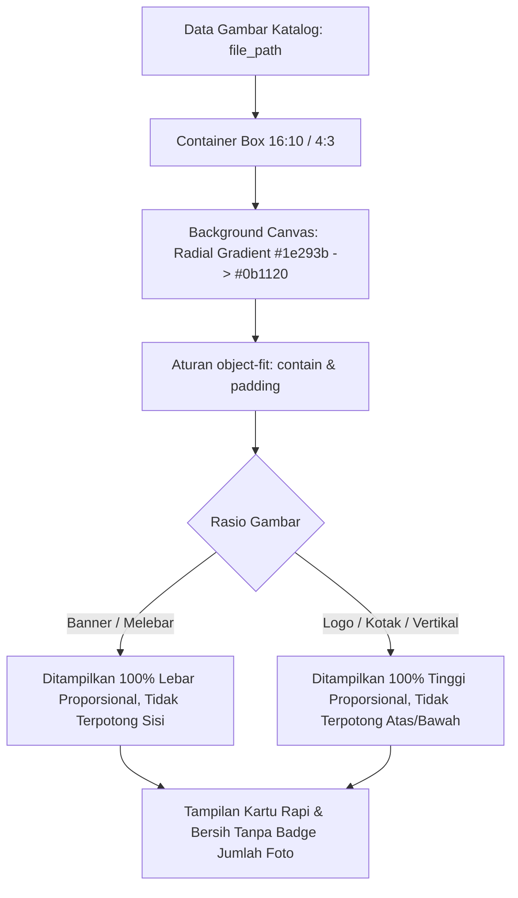
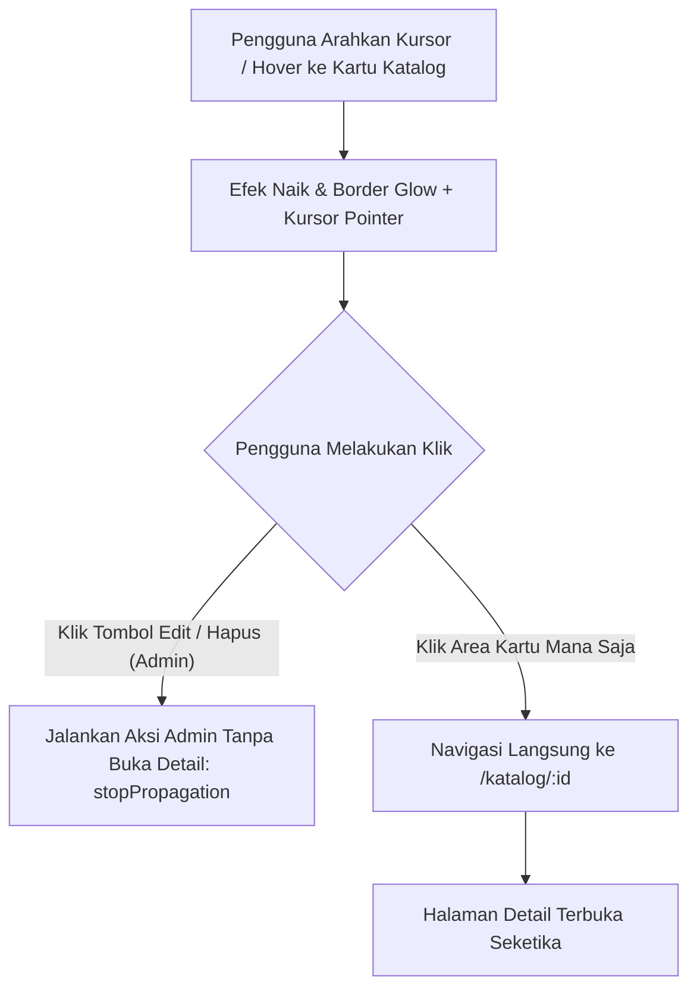
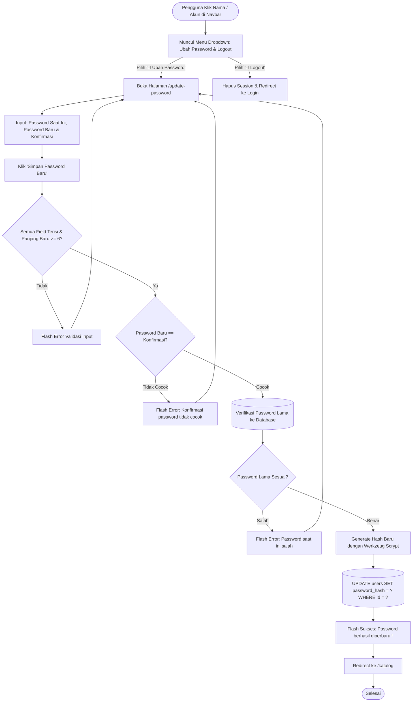
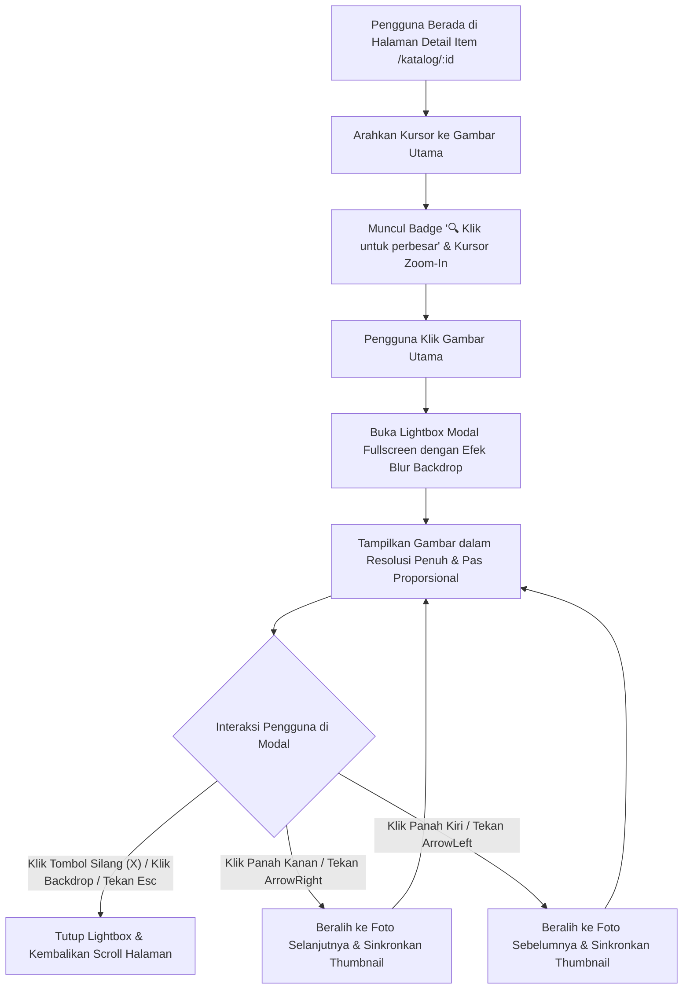
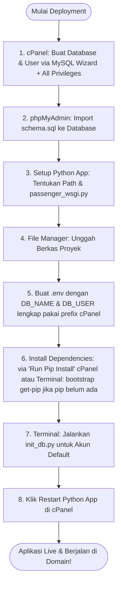

# 📊 Flowchart Sistem Aplikasi Web Laboratorium Peralatan Diagnostik

Dokumen ini memuat diagram alur proses (*flowchart*) menyeluruh untuk aplikasi Web Laboratorium Peralatan Diagnostik berbasis Python Flask dan MySQL (phpMyAdmin), sesuai aturan pembaruan dokumentasi berkala.

---

## 1. Diagram Arsitektur & Hak Akses (Role-Based Access)

---

## 2. Alur Autentikasi Pengguna (Login & Logout)

---

## 3. Alur Pengelolaan Katalog (Input/Edit 1-5 Gambar & Thumbnail)

> **Catatan Status Awal:** Saat aplikasi baru diinisialisasi atau dimulai, tabel `katalog` dan `katalog_gambar` berada dalam kondisi **benar-benar kosong (0 data)** dan direktori `static/uploads/katalog/` bersih, menampilkan pesan *"Katalog Masih Kosong"*.

---

## 4. Mekanisme Anti-Duplikasi Notifikasi (Rule #1)

---

## 5. Alur Pemrosesan Tampilan Thumbnail & Pratinjau Gambar (Fit & Pas)

---

## 6. Alur Interaksi Klik Kartu Katalog (Direct Card Click Navigation)

---

## 7. Alur Pembaruan Kata Sandi Mandiri (Update Password Flow)

---

## 8. Alur Pratinjau Perbesar Gambar (Lightbox Modal Image Zoom)

---

## 9. Diagram Alur Deployment Shared Hosting (cPanel Phusion Passenger)

